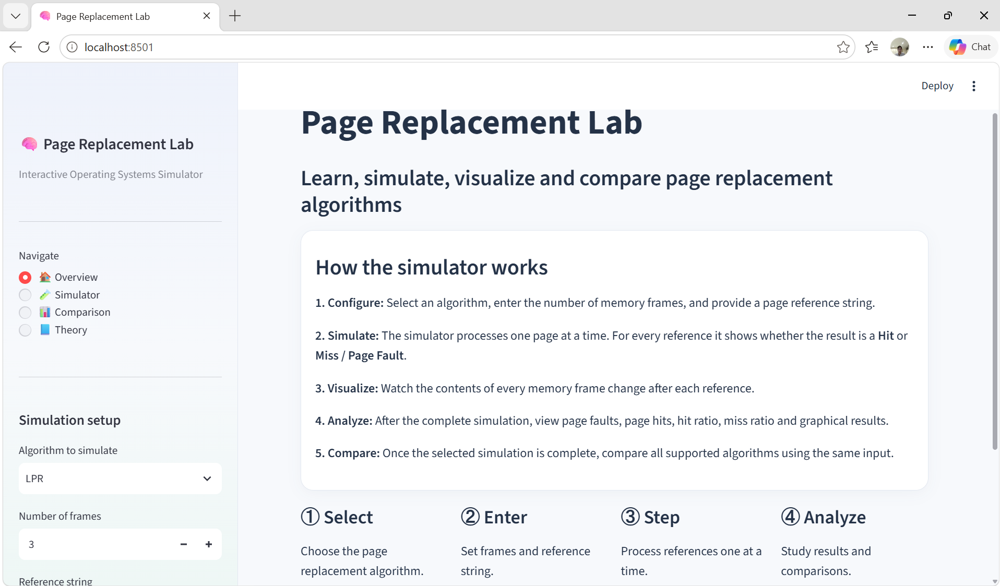
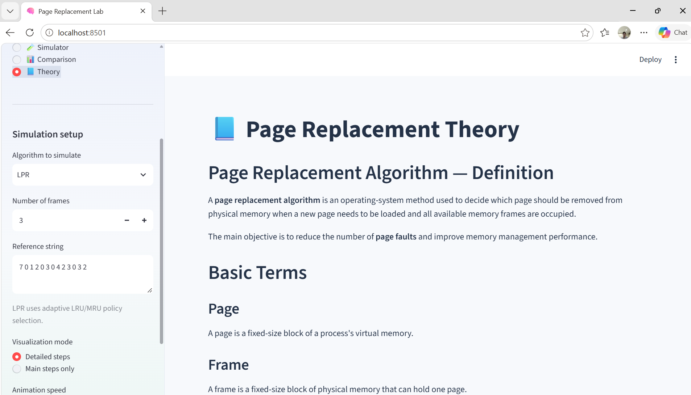
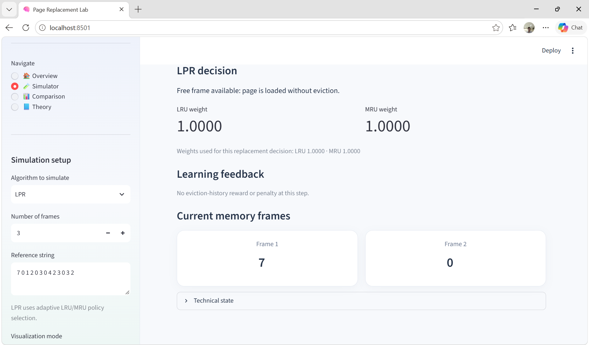
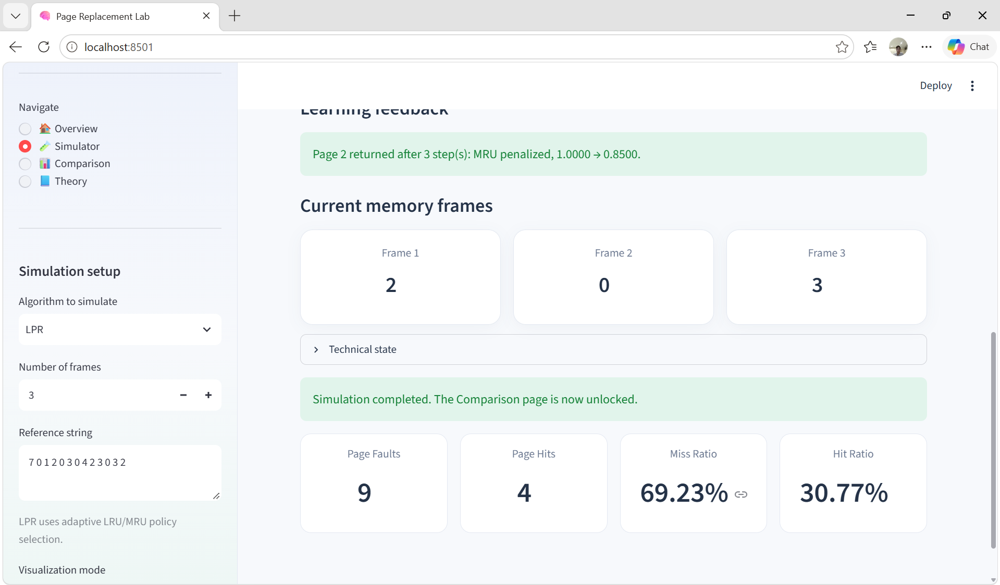
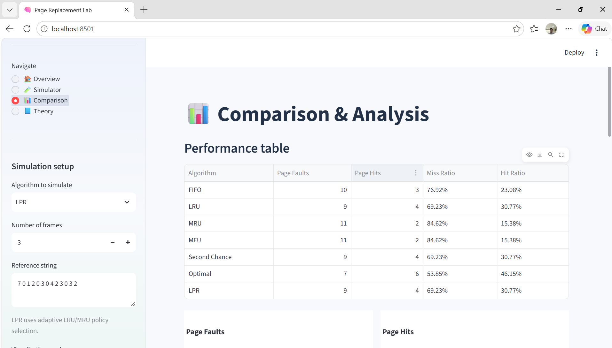

# Page Replacement Lab — Updated LPR Learning Feedback

Interactive Streamlit simulator for FIFO, LRU, MRU, MFU, Second Chance (Clock), Optimal, and adaptive LPR (LRU/MRU).

## What's updated
- LPR records the weights used for each replacement decision separately from the weights after feedback.
- Detailed Steps displays the current LRU/MRU weights, their change for the step, and the learning feedback explaining each reward or penalty.
- If a page is requested again after eviction, the policy responsible is penalized by multiplying its weight by `1 - alpha` (default `0.85`).
- If an evicted page is not requested within five steps, its policy is rewarded by `alpha * 0.5` (default `+0.075`).
- Weights are not normalized. Exploitation selects the policy with the larger weight; epsilon-greedy exploration can randomly choose either policy.
- Added MFU with resident-page access-frequency tracking.
- Added Second Chance with reference bits and a circular clock pointer.
- Both new algorithms appear in the selector, theory page, step-by-step simulator, and comparison charts/table.
- Other algorithms and the existing interface are retained.

## Run on Windows
1. Extract the ZIP.
2. Open the extracted `Page_Replacement` folder in Command Prompt or PowerShell.
3. Run:

```powershell
python -m pip install -r requirements.txt
python -m streamlit run app.py
```

Or double-click `run.bat`.

## Test example for changing weights and policy
Set algorithm to **LPR**, frames to **3**, and reference string to:

```text
1 2 3 4 1 2
```

The page 1 return penalizes the policy that evicted page 1. The resulting unequal weights affect the next replacement decision. The simulator's detailed view shows the exact decision weights and feedback events at each step. Because the algorithm includes seeded epsilon-greedy exploration, a random exploration choice can occasionally select the other policy.


## Application Screenshots

The following screenshots show the main sections of the Page Replacement Lab application. Images are stored in the `screenshots/` folder and are displayed here using relative paths.

### 1. Overview — Page Replacement Lab

The overview page introduces the simulator workflow: configure an algorithm, enter the frame count and reference string, run the simulation, and analyze the results.



### 2. Theory — Page Replacement Concepts

The Theory page explains page replacement and basic memory-management terms. Use it to review the concepts behind the supported algorithms.



### 3. LPR Simulator — Adaptive Replacement Decision

The simulator displays the current memory frames and the LPR decision. It also shows the LRU and MRU policy weights used for a replacement decision.



### 4. LPR Learning Feedback and Simulation Results

The learning-feedback message explains when a policy is rewarded or penalized after an evicted page is requested again. At the end of a simulation, summary metrics include page faults, page hits, miss ratio, and hit ratio.



### 5. Comparison and Performance Analysis

The comparison page compares algorithms using the same frame count and reference string, with a performance table and charts for page faults and page hits. The supported algorithms include FIFO, LRU, MRU, MFU, Second Chance, Optimal, and LPR.


